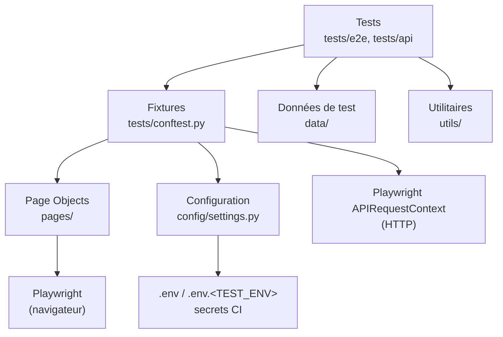
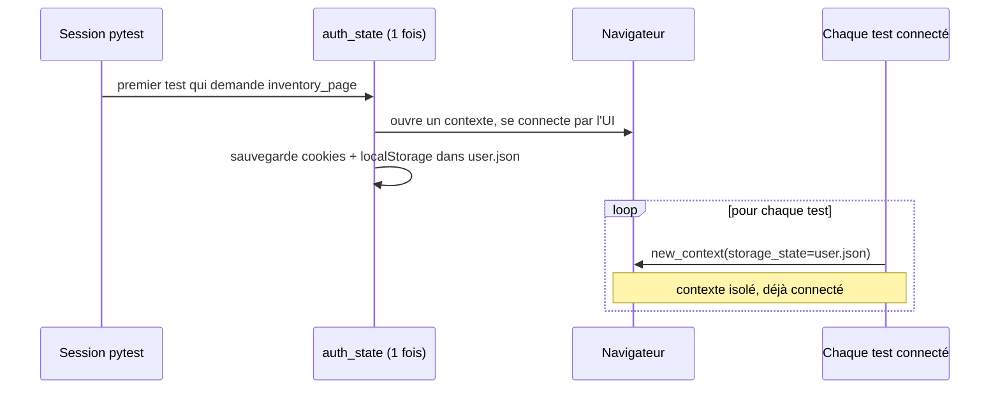
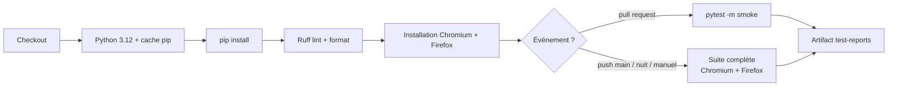

# Documentation technique

Ce document décrit l'architecture du framework de tests, le rôle de chaque fichier, le fonctionnement
interne (configuration, fixtures, authentification) et les procédures pour faire évoluer le projet.
Pour l'installation et les commandes de base, voir le [README](../README.md).

---

## 1. Vue d'ensemble

| Élément | Choix |
|---|---|
| Langage | Python 3.11+ |
| Outil d'automatisation | [Playwright](https://playwright.dev/python/) (API synchrone) |
| Lanceur de tests | [pytest](https://docs.pytest.org/) + [pytest-playwright](https://playwright.dev/python/docs/test-runners) |
| Parallélisation | pytest-xdist (`-n auto`) |
| Relance des tests en échec | pytest-rerunfailures (`--reruns 1`, en CI uniquement) |
| Rapports | pytest-html (HTML), JUnit XML, traces / vidéos / captures Playwright |
| Configuration | python-dotenv (`.env`, `.env.<TEST_ENV>`) |
| Qualité de code | Ruff (lint + format) |
| CI | GitHub Actions |
| Application testée (démo) | UI : saucedemo.com, API : jsonplaceholder.typicode.com |

Types de tests couverts :
- **E2E (UI)** : parcours utilisateur dans un vrai navigateur (`tests/e2e/`)
- **API** : appels HTTP directs, sans navigateur (`tests/api/`)

---

## 2. Architecture en couches



Chaque couche a une seule responsabilité :

| Couche | Responsabilité | Ne doit PAS contenir |
|---|---|---|
| Tests | Décrire un comportement attendu (Arrange / Act / Assert) | Sélecteurs, URL, mots de passe |
| Fixtures | Préparer et nettoyer l'environnement d'un test | Assertions métier |
| Page Objects | Sélecteurs et actions d'une page | Logique de test, données en dur |
| Données | Valeurs utilisées par les tests | Code |
| Configuration | Valeurs dépendantes de l'environnement | Valeurs secrètes en dur |

---

## 3. Arborescence et rôle des fichiers

```
playwright-tests/
├── .github/workflows/playwright.yml   pipeline CI
├── config/
│   ├── __init__.py
│   └── settings.py                    configuration centralisée (objet `settings`)
├── data/
│   ├── __init__.py
│   ├── login_cases.json               cas de connexion invalides (data-driven)
│   └── products.py                    libellés des produits
├── docs/
│   └── DOCUMENTATION_TECHNIQUE.md     ce document
├── pages/
│   ├── __init__.py
│   ├── base_page.py                   classe parente des Page Objects
│   ├── login_page.py                  page de connexion
│   └── inventory_page.py              page catalogue
├── tests/
│   ├── conftest.py                    fixtures partagées
│   ├── e2e/
│   │   ├── test_login.py              tests de connexion
│   │   └── test_inventory.py          tests du catalogue
│   └── api/
│       └── test_posts.py              tests de l'API /posts
├── utils/
│   ├── __init__.py
│   └── helpers.py                     unique_id, load_json
├── .env.example                       modèle des variables d'environnement
├── .gitignore                         fichiers non versionnés
├── pyproject.toml                     configuration Ruff
├── pytest.ini                         configuration pytest
├── requirements.txt                   dépendances (versions figées)
└── README.md                          guide de démarrage
```

Chaque fichier commence par un commentaire (ou une docstring) qui rappelle son rôle.
Seule exception : `data/login_cases.json`, car le format JSON n'accepte pas de commentaires.
Son format est décrit au [§ 8.1](#81-format-de-datalogin_casesjson).

**Dossiers générés (non versionnés)** :

| Dossier | Contenu |
|---|---|
| `reports/` | `report.html` (rapport lisible) et `junit.xml` (lu par les outils de CI) |
| `test-results/` | Captures d'écran, vidéos et traces des tests en échec |
| `playwright/.auth/` | `user.json` : état de session sauvegardé (cookies, localStorage) |

---

## 4. Configuration

### 4.1 Ordre de résolution

`config/settings.py` est chargé au premier import et résout chaque valeur dans cet ordre :

1. Variables d'environnement déjà définies (shell, CI)
2. `.env.<TEST_ENV>` (par exemple `.env.staging`) : **surcharge** les valeurs de `.env`
3. `.env`
4. Valeur par défaut dans le code (uniquement pour les URL et comptes de la démo)

Si une variable n'a aucune valeur (absente ou vide), `RuntimeError("Variable d'environnement manquante : ...")`
est levée dès le démarrage : on préfère échouer tout de suite plutôt que lancer des tests mal configurés.

> En CI, une variable alimentée par un secret qui n'existe pas vaut `""` (chaîne vide).
> Elle est donc considérée comme manquante et les tests s'arrêtent : il faut créer les secrets.

### 4.2 Variables disponibles

| Variable | Utilisation | Exemple |
|---|---|---|
| `TEST_ENV` | Choisit le fichier `.env.<TEST_ENV>` | `dev`, `staging` |
| `BASE_URL` | URL de l'application (tests UI) | `https://www.saucedemo.com` |
| `API_URL` | URL de base de l'API | `https://jsonplaceholder.typicode.com` |
| `STANDARD_USER` | Compte valide | `standard_user` |
| `LOCKED_USER` | Compte bloqué | `locked_out_user` |
| `USER_PASSWORD` | Mot de passe des comptes | *(secret)* |

### 4.3 Ajouter une variable

1. L'ajouter dans `.env.example` (avec une valeur d'exemple, jamais un vrai secret)
2. L'ajouter comme champ de la classe `Settings` dans `config/settings.py`
3. Si c'est un secret : le créer dans GitHub et l'ajouter au bloc `env:` de `.github/workflows/playwright.yml`

---

## 5. Fixtures (tests/conftest.py)

pytest injecte une fixture dans un test quand le test la déclare en paramètre.
La **portée** (scope) indique combien de fois elle est créée.

| Fixture | Portée | Rôle | Dépend de |
|---|---|---|---|
| `base_url` | session | URL utilisée par `page.goto("/...")` | `settings` |
| `_test_id_attribute` | session, auto | Fait cibler l'attribut `data-test` par `get_by_test_id()` | `playwright` |
| `browser_context_args` | session | Options des contextes navigateur (taille de fenêtre...) | pytest-playwright |
| `auth_state` | session | Connexion unique, sauvegarde de la session dans `playwright/.auth/user.json` | `browser` |
| `auth_page` | test | Nouvelle page **déjà connectée** | `new_context`, `auth_state` |
| `login_page` | test | `LoginPage` sur une page **non connectée** | `page` |
| `inventory_page` | test | `InventoryPage` sur une page connectée | `auth_page` |
| `api` | session | Client HTTP pointant sur `API_URL` | `playwright` |

Fixtures fournies par pytest-playwright et utilisées ici : `playwright`, `browser`, `page`, `new_context`.

### 5.1 Fonctionnement de l'authentification



Avantages :
- la connexion par l'UI n'est faite qu'**une fois** : les tests sont plus rapides et moins fragiles ;
- chaque test garde **son propre contexte**, donc les tests restent indépendants (paniers séparés, etc.) ;
- comme `auth_page` passe par `new_context`, pytest-playwright gère quand même les captures, vidéos et traces.

Avec `-n auto`, chaque worker xdist est un processus séparé et fait sa propre connexion.

---

## 6. Page Object Model

### 6.1 Principe

Une classe par page. Elle contient :
- les **locators**, déclarés dans `__init__` ;
- des **méthodes d'action** au vocabulaire métier (`login`, `add_to_cart`) ;
- éventuellement des **vérifications réutilisables** (`expect_loaded`, `expect_error`).

Les tests n'utilisent jamais `page.locator(...)` directement : si l'interface change, seul le Page Object est modifié.

### 6.2 Stratégie de sélecteurs (par ordre de préférence)

1. `get_by_test_id("...")` : attribut dédié aux tests (`data-test` ici), le plus stable
2. `get_by_role("button", name="...")` : proche de ce que voit l'utilisateur, accessible
3. `get_by_label`, `get_by_placeholder`, `get_by_text`
4. CSS simple, en dernier recours
5. ❌ À éviter : XPath absolus, classes CSS générées, index (`nth(3)`)

### 6.3 Attentes

Playwright attend automatiquement que l'élément soit visible et actionnable avant d'agir.
Les assertions `expect(...)` réessaient jusqu'au timeout (5 s par défaut).
**Ne jamais utiliser** `time.sleep()` ni `page.wait_for_timeout()`.

---

## 7. Écrire un nouveau test

### 7.1 Ajouter une page

```python
# pages/cart_page.py
"""Page Object de la page panier."""

from playwright.sync_api import Page

from pages.base_page import BasePage


class CartPage(BasePage):
    path = "/cart.html"

    def __init__(self, page: Page) -> None:
        super().__init__(page)
        self.items = page.get_by_test_id("inventory-item")
        self.checkout_button = page.get_by_test_id("checkout")

    def checkout(self) -> None:
        self.checkout_button.click()
```

Puis exposer la page avec une fixture dans `tests/conftest.py` :

```python
@pytest.fixture
def cart_page(auth_page: Page) -> CartPage:
    return CartPage(auth_page)
```

### 7.2 Ajouter un test

```python
# tests/e2e/test_cart.py
"""Tests E2E de la page panier."""

import pytest
from playwright.sync_api import expect

from data import products


@pytest.mark.regression
def test_produit_ajoute_apparait_dans_le_panier(inventory_page, cart_page) -> None:
    # Arrange
    inventory_page.goto()
    inventory_page.add_to_cart(products.BACKPACK)

    # Act
    cart_page.goto()

    # Assert
    expect(cart_page.items).to_have_count(1)
```

> Note : `inventory_page` et `cart_page` reposent tous les deux sur la même fixture `auth_page`.
> pytest la crée une seule fois par test, donc ils partagent la même page (le panier est conservé).

### 7.3 Règles

- Nom de fichier `test_<fonctionnalité>.py`, nom de test `test_<comportement_attendu>`
- Au moins un marker (`smoke`, `regression` ou `api`)
- Un test vérifie **un** comportement et peut tourner seul, dans n'importe quel ordre
- Les données variables passent par `data/` ou `@pytest.mark.parametrize`
- Les données créées doivent être uniques (`unique_id()`) pour supporter l'exécution parallèle

---

## 8. Données de test

### 8.1 Format de `data/login_cases.json`

Liste d'objets, un objet = un test généré par `test_connexion_refusee` :

| Clé | Type | Rôle |
|---|---|---|
| `id` | texte | Nom du cas, affiché dans le nom du test (`test_connexion_refusee[chromium-username-vide]`) |
| `username` | texte | Identifiant saisi (peut être vide) |
| `password` | texte | Mot de passe saisi (peut être vide) |
| `error` | texte | Partie du message d'erreur attendu |

Ajouter un cas = ajouter un objet dans le fichier, aucun code à modifier.

### 8.2 `data/products.py`

Constantes des libellés produits, importées avec `from data import products`.

---

## 9. Markers et sélection des tests

| Marker | Signification | Quand c'est lancé |
|---|---|---|
| `smoke` | Parcours critiques, rapides | Chaque pull request |
| `regression` | Couverture fonctionnelle complète | Chaque nuit et à chaque push sur `main` |
| `api` | Tests sans navigateur | Avec la suite complète |

Exemples : `pytest -m smoke`, `pytest -m "regression and not api"`, `pytest -k login`.
Pour ajouter un marker : le déclarer dans `pytest.ini` (sinon `--strict-markers` le refuse).

---

## 10. Rapports et débogage

| Besoin | Commande / emplacement |
|---|---|
| Rapport HTML | `reports/report.html` |
| Résultat pour la CI | `reports/junit.xml` |
| Capture / vidéo d'un échec | `test-results/<nom-du-test>/` |
| Rejouer pas à pas un échec | `playwright show-trace test-results/<nom-du-test>/trace.zip` |
| Voir le navigateur | `pytest --headed --slowmo 500` |
| Debug interactif | `PWDEBUG=1 pytest -k <nom>` (Playwright Inspector) |
| Trouver un sélecteur | `playwright codegen <url>` |

La trace contient chaque action, les captures DOM avant/après, le réseau et la console :
c'est l'outil principal pour analyser un échec en CI (à télécharger dans l'artifact `test-reports`).

---

## 11. Intégration continue

Fichier : `.github/workflows/playwright.yml`



**Configuration requise dans GitHub** (Settings → Secrets and variables → Actions) :

| Type | Nom | Obligatoire |
|---|---|---|
| Secret | `STANDARD_USER`, `LOCKED_USER`, `USER_PASSWORD` | Oui |
| Variable | `BASE_URL`, `API_URL` | Non (valeurs de la démo par défaut) |

---

## 12. Qualité de code

- `ruff check .` : erreurs, imports, bonnes pratiques pytest
- `ruff format .` : formatage automatique
- Ces deux contrôles sont exécutés en CI : une PR qui ne les passe pas échoue.
- Toute modification passe par une branche et une pull request relue.

---

## 13. Problèmes fréquents

| Symptôme | Cause probable | Solution |
|---|---|---|
| `RuntimeError: Variable d'environnement manquante` | `.env` absent ou secret GitHub non créé | Copier `.env.example` en `.env`, ou créer le secret |
| `Executable doesn't exist ...` | Navigateurs Playwright non installés | `playwright install chromium firefox` |
| `ModuleNotFoundError: No module named 'pages'` | pytest lancé hors de la racine du projet | Lancer `pytest` depuis la racine (où se trouve `pytest.ini`) |
| `'xxx' not found in markers configuration` | Marker non déclaré | L'ajouter dans `pytest.ini` |
| Timeout sur un `expect` | Mauvais sélecteur, ou page trop lente | Vérifier avec `codegen` / la trace ; ne pas ajouter de `sleep` |
| Test qui passe en local et échoue en CI | Dépendance à des données ou à l'ordre des tests | Rendre le test indépendant, utiliser `unique_id()` |
| `net::ERR_TUNNEL_CONNECTION_FAILED` / `ENOTFOUND` | Réseau / proxy bloquant le site | Vérifier l'accès réseau à `BASE_URL` / `API_URL` |
